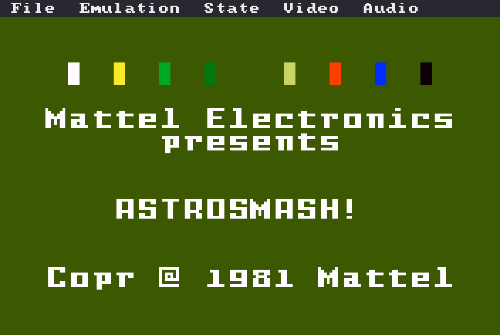

# Intelliemu

Intelliemu is a standalone Mattel Intellivision emulator for GNU/Linux, using an SDL3 GUI. Originally based off freeintv.
- Version 2.0, 11-18-26

## Loader System

- Intelliemu has two means of loading roms, a classic loader and a newer bankswitching loader.
- Classic can handle all of the existing .int format roms out there, it has support for JLP and ECS. It accepts .rom or .int files.
- Bankswitching Loader can handle all of the newer, high-tech homebrew mappers (Intellicart, SDK-1600, etc). It accepts bin/cfg or int/cfg.
- Bankswitching Loader -requires- a cfg to load a rom file, so stuff like bankworld.rom has to be converted to bin/cfg with rom2bin to work on Intelliemu.

## Authors & Contributors

Originally based on freeintv by David Richardson.
The PSG and STIC emulation was made closer to hardware and optimized by Oscar Toledo G. (nanochess), who also added save states.

The Intellivoice code has been contributed by Joe Zbiciak (author of jzintv), and adapted by Oscar Toledo G. (nanochess)

jzutils is a fork of Joe Zbiciak's AS1600/jzintv's development tools.

**SDL3 GNU/Linux Port**: Created by R.Shaklfrd and Claude Haiku.

<div style="margin: 18px 0;"></div>

## Building

Requirements: Linux, CMake 3.16+, GCC, and SDL3 development files (tested with SDL 3.4.20; build SDL3 from source if your distribution does not package it).

```sh
cmake -S . -B release -DCMAKE_BUILD_TYPE=Release   # configure
cmake --build release                             # build
```

Output goes to `release/`:
- `intelliemu`: the standalone emulator
- `intelliemu.so`: the core, which `intelliemu` loads at runtime (Not intended to be used with Retroarch, and will likely not work if you try)
- `gamecontrollerdb.txt`: SDL gamepad mappings, copied from `Assets/` at build time and read beside `intelliemu`

To build only the libretro core without SDL3, configure with `-DINTELLIEMU_STANDALONE=OFF`. If CMake cannot find SDL3, add `-DCMAKE_PREFIX_PATH=<prefix>` to the configure step.

## Quick Start

1. Put the BIOS files in one of the folders listed in [BIOS](#bios).
2. Start a game with that folder:

   ```sh
   ./release/intelliemu -s /path/to/bios Game.int
   ```

   Or run `./release/intelliemu` and open a ROM with Ctrl+O.

## Documentation

See [USER_GUIDE.md](USER_GUIDE.md) for running games, menus, controls, settings, and known limitations.

## License
IntelliEmu is licensed under GPLv2.
jzutils is licensed under GPLv2.

## BIOS
Intelliemu needs two Intellivision BIOS images, and accepts an optional third for the Entertainment Computer System. It searches these folders in order, and uses the first matching file for each image:

1. `~/.config/Intelliemu/bios/` (or `$XDG_CONFIG_HOME/Intelliemu/bios/`)
2. `bios/` beside `release/intelliemu`
3. The folder given by `-s` or the `system_dir` setting (default: the current directory)

| Function | Accepted filenames* | Size | MD5 Hash |
| --- | --- | --- | --- |
| Executive ROM | `exec.bin`, `executive.bin`, `execrom.bin`, `erom.bin`, `INTV_EROM.bin` | 8192 bytes | `62e761035cb657903761800f4437b8af` |
| Graphics ROM | `grom.bin`, `graphics.bin`, `graphicsrom.bin`, `INTV_GROM.bin` | 2048 bytes | `0cd5946c6473e42e8e4c2137785e427f` |
| ECS ROM (optional) | `ecs.bin`, `ECS.bin` | 24576 bytes | `2e72a9a2b897d330a35c8b07a6146c52` |

* Names match regardless of case, punctuation, a leading `INTV`, and a `.bin` or `.rom` extension. Files of the wrong size are skipped. Zip archives are not read, so extract the `.bin` files first.

## Entertainment Computer System
The ECS ROM is only used by the cartridges that need it: World Series Major League Baseball, Mind Strike, Melody Blaster, The Jetsons' Ways With Words, Number Jumble, and Scooby-Doo's Maze Chase. Without `ECS.bin`, those cartridges will not run correctly. The ECS keyboard and the ECS sound chip (PSG2) are emulated. The ECS keyboard is off by default; turn it on with **Emulation > ECS keyboard** (see [USER_GUIDE.md](USER_GUIDE.md)). Music keyboard games, such as Melody Blaster, need a real music keyboard, which is not emulated.
